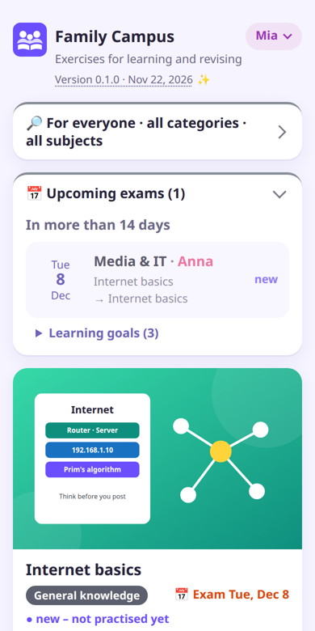
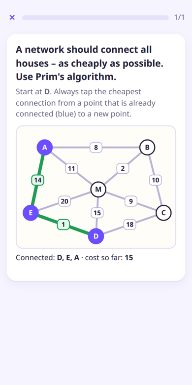

# Family Campus

A small, self-hosted learning site for families. Short interactive exercises
("tiles") with a summary sheet, a progress page and spaced repetition – for
school, apprenticeships, studies and further education. Every person logs in
with their own name; parents see everyone's progress.

> **Version 1.0.0** – the first public release. Feedback and contributions are welcome.

<p align="center">
  
  
</p>

## Features

- **Tiles**: every tile has a summary sheet ("learn first") and several short
  sets of questions – multiple choice, typed answers (tolerant of small
  typos), tables, matching, ordering, tapping words, sorting, figures – and
  questions generated anew on every run.
- **Spaced repetition**: wrong answers come back after 1, 3, 7, 14 and 30 days
  until they stick.
- **Progress per person**: finished sets, best results, activity, recent
  mistakes; parents can look at everybody.
- **Exams and focus**: upcoming exams with their learning goals at the top,
  a curated focus list per person.
- **For the whole family**: content is organised by category → area → level
  (school years, apprenticeship years, …), not by person, so it can be reused.
- **Languages**: English by default, German for Germany and Switzerland; every
  person chooses their language; dates and numbers follow the locale.
- **Simple to host**: one Python file (standard library only), SQLite, static
  pages; a small Docker image; installable as an app on phones.
- **Your data stays yours**: your family's people, exams and tiles live in
  your *campus* (`my-family/`), a folder Family Campus's git ignores.
- **Source modules** (optional): fetch your own children's exams and learning
  goals from a school platform on your computer, e.g. Escola or Moodle – used at your
  own responsibility, see [sources/](sources/README.md).

## Quick start (demo)

The demo shows the invented example family (`example-family/`). Needs
Python 3.11 or newer.

```bash
git clone https://github.com/chaeller/family-campus.git
cd family-campus
python3 tools/build.py                       # builds the demo (example family) into build/www
mkdir -p data && cp example-family/campus.env.example data/campus.env
python3 server/server.py --www build/www --data data --port 8080
```

Open <http://localhost:8080/> and log in as **Anna** (password `anna`), **Ben**
(`ben`) or the parent **Mia** (`mia`). The demo has one tile, "Internet basics".
The build runs without Playwright; the self test of tiles
(`tools/selftest.py`) needs [Playwright](https://playwright.dev/python/) with Chromium.

These commands are for the demo only. For your own family use the scripts
below – they call `tools/build.py` themselves.

## Your family: my-family

my-family is the folder `my-family/` in your clone: your family's people,
exams, tiles and deployment values. Family Campus's git ignores it – `git pull`
brings updates of Family Campus, and your data never ends up in the Family Campus repository.

```bash
tools/new-campus.sh            # once: creates my-family/ from the example family, builds and tests it
tools/campus-build.sh          # after every change: builds my-family/build/www, self test, checks
tools/campus-serve.sh          # preview; prints the address (http://localhost:8080/ plus your URL path)
```

The preview uses the logins in `my-family/data/campus.env` and keeps its
database in `my-family/data/`.

Want a backup or version history? Make `my-family/` its own git repository
and push it to a private server of yours – Family Campus's git still ignores it.
Details: [docs/getting-started.md](docs/getting-started.md).

## Documentation

| Document | Content |
| --- | --- |
| [docs/getting-started.md](docs/getting-started.md) | Demo, creating my-family, local test, backup, release, updates of Family Campus |
| [docs/my-family.md](docs/my-family.md) | Reference of my-family files |
| [docs/tiles.md](docs/tiles.md) | Writing tiles: content modules, question types, extensions, tests |
| [docs/languages.md](docs/languages.md) | Languages and locales, adding a translation |
| [docs/architecture.md](docs/architecture.md) | Components, build, data model, server API, database |
| [docs/operations.md](docs/operations.md) | Docker, deployment, logins, backup, releases |
| [sources/](sources/README.md) | Source modules for school platforms, legal and responsible use |
| [docs/adr/](docs/adr/README.md) | Architecture decision records |
| [CONTRIBUTING.md](CONTRIBUTING.md) | How to contribute |
| [CHANGELOG.md](CHANGELOG.md) | Changes per version |

Working with a coding agent (Claude Code): the skills in `.claude/skills/`
(`/fc-ingest`, `/fc-improve`, `/fc-check`, `/fc-release`, `/fc-deploy`) guide
new tiles, checks, releases and deployments of my-family; start Claude Code
in the Family Campus folder (ADR-0014).

## Licence

[MIT](LICENSE). The demo tile is written for this project; tiles you build
from teaching material stay in my-family and are never published (ADR-0013).
